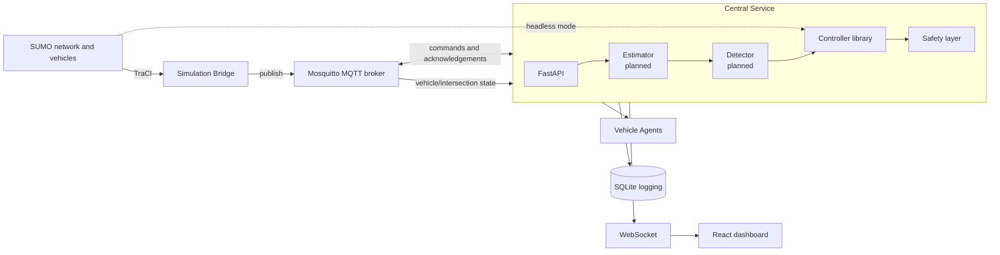

# VYRO Architecture

## Component diagram

In headless mode, SUMO or a test runner calls the pure `vyro_controller`
library directly; it does not use MQTT or simulator ground truth. The
architecture diagram is the target integration: some components are not yet
implemented in the running system.

## Components

| Component | Owner | Language | Status |
| --- | --- | --- | --- |
| SUMO network and synthetic routes | P1 | XML / SUMO | simulated |
| TraCI integration | P1 | Python | implemented |
| Simulation bridge | P1 | Python | implemented for `VehicleState`; other commands planned |
| Mosquitto MQTT broker | P1/P2 | Mosquitto config | implemented |
| FastAPI, MQTT ingestion, state, WebSocket | P2/P3 | Python | implemented |
| Estimator | P2/P3 | Python | proposed |
| Detector and detector-count ingestion | P2/P3 | Pydantic / Python | simulated |
| Controller library: Webster baseline | P2 | Python | implemented |
| Controller phase selection | P2 | Python | proposed |
| Safety validation and preemption coordination | P2/P3 | Python | simulated |
| Vehicle agents and synthetic advisories | P3 | Python | simulated |
| SQLite message logging | P3 | Python / SQLite | implemented |
| React dashboard and network map | P4 | JavaScript / TypeScript / React | implemented |

## Message types and topics

The repository schemas are Pydantic models in `backend/src/vyro_backend/schemas/`
and have v0.2 JSON examples in `schemas/examples/`. The frozen topic namespace
is `vyro/v1/#`.

| Message type | MQTT topic | Example file |
| --- | --- | --- |
| `VehicleState` | `vyro/v1/vehicle/state` | `schemas/examples/vehicle_state.json` |
| `IntersectionState` | `vyro/v1/intersection/state` | `schemas/examples/intersection_state.json` |
| `SignalCommand` | `vyro/v1/controller/command` | `schemas/examples/signal_command.json` |
| `ControllerAck` | `vyro/v1/controller/ack` | `schemas/examples/controller_ack.json` |
| `VehicleAdvisory` | `vyro/v1/vehicle/advisory` | `schemas/examples/vehicle_advisory.json` |
| `PreemptionRequest` | `vyro/v1/preemption/request` | `schemas/examples/preemption_request.json` |
| `MetricsSnapshot` | `vyro/v1/metrics/snapshot` | `schemas/examples/metrics_snapshot.json` |

Messages use JSON UTF-8, QoS 1, and a `schema_version` field. Schema freezing
to v1.0 is not yet complete.

## Known unknowns for Week 2

- **Calibrated demand:** the Yerevan network uses synthetic routes and placeholder
  900-veh/h demand, not measured traffic counts.
- **Network completeness:** the selected OSM extract has clipped turn restrictions
  and disconnected fringe roads; its practical route coverage is not yet settled.
- **Controller policy:** the current `decide()` API holds the observed phase; a
  validated queue-pressure or Webster dynamic policy is proposed.
- **TraCI command integration:** MQTT command and acknowledgement schemas exist,
  but applying live phase changes and reporting end-to-end acknowledgements to
  SUMO remain planned.
- **Preemption integration:** preemption coordination exists as a Python helper,
  but its TraCI and MQTT operating behavior is not yet validated.
